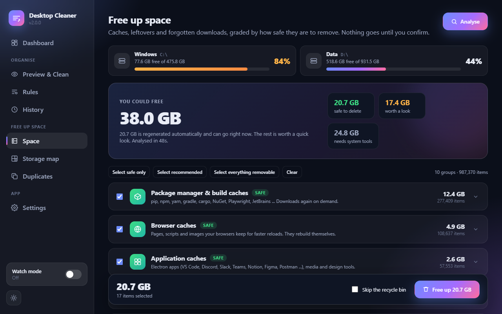
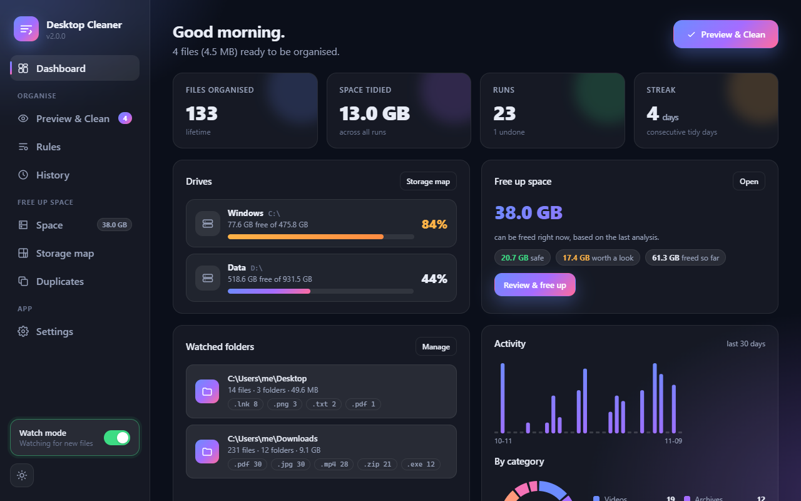
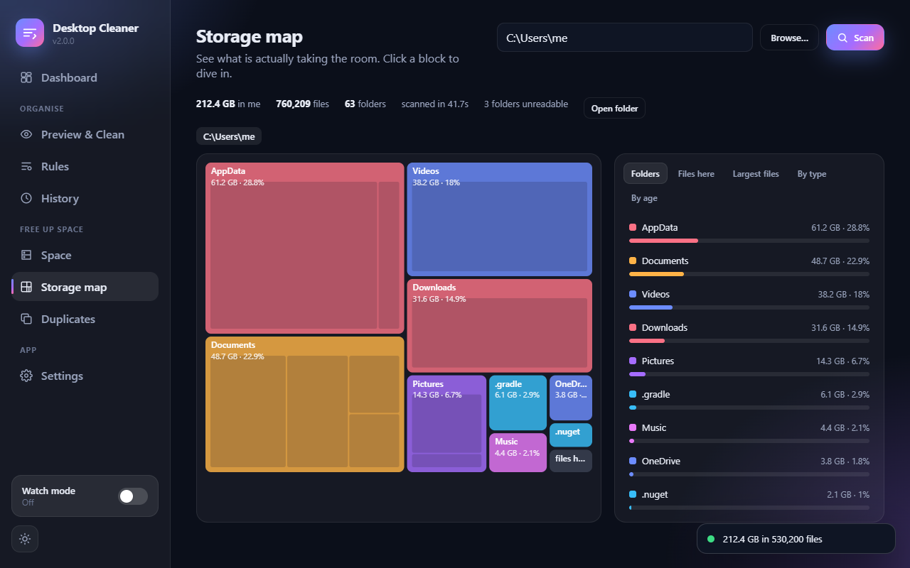
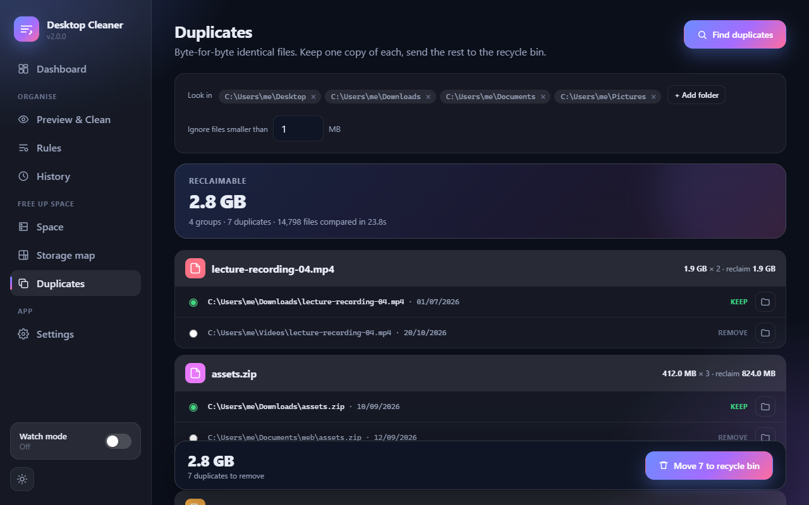
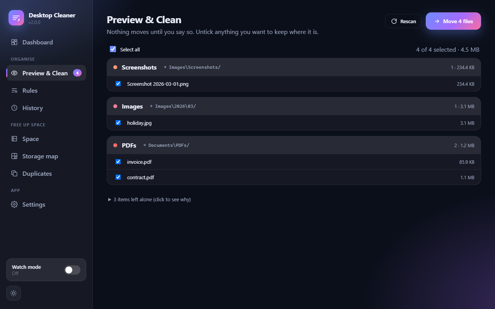
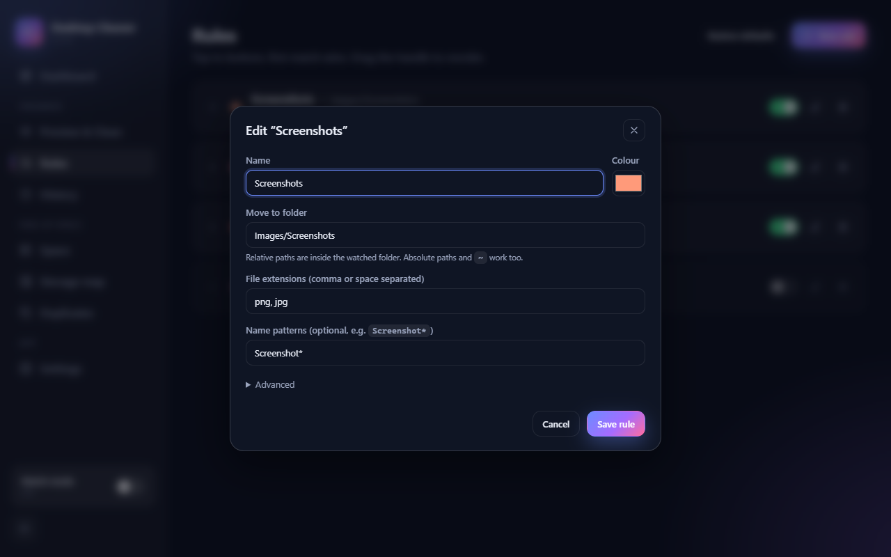
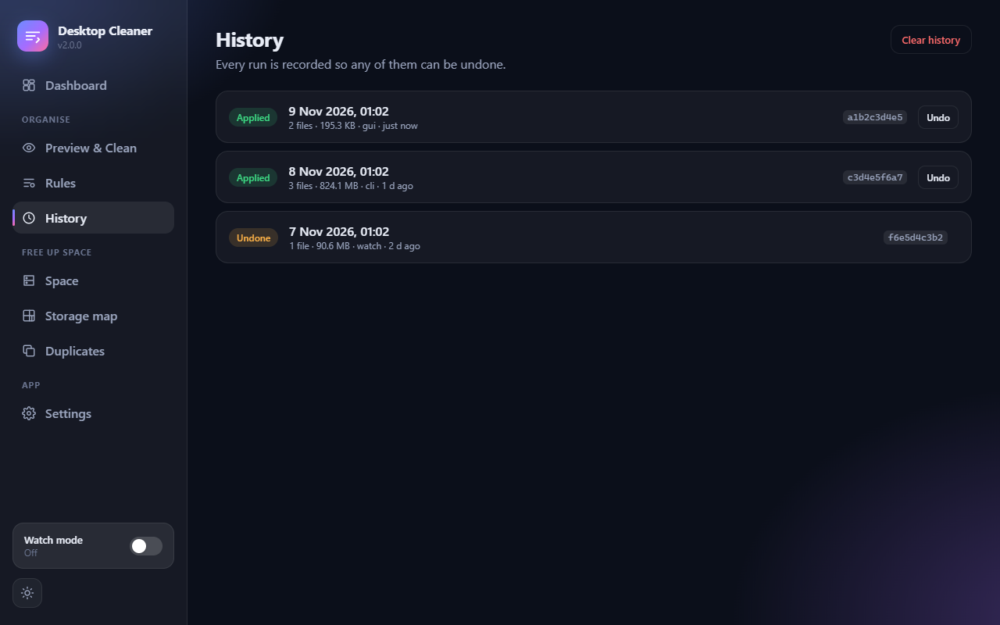
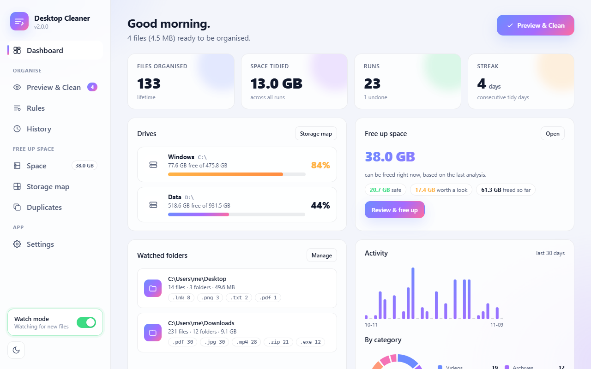

<div align="center">



# Desktop Cleaner

**Tidy folders and a lighter disk, with nothing happening behind your back.**<br>
Organise your Desktop and Downloads with rules. Find and remove the gigabytes of caches, leftovers and duplicates hiding on your machine. Preview first, undo after.

[](https://www.python.org/)
[](LICENSE)
[](#install)
[](#project-layout)
[](https://pywebview.flowrl.com/)
[](#develop)
[](pyproject.toml)

[Install](#install) · [Free up space](#free-up-space) · [Organise](#organise-your-folders) · [Screenshots](#screenshots) · [CLI](#command-line) · [Configuration](#configuration) · [Safety](#how-safe-is-it) · [FAQ](#faq) · [Develop](#develop)

</div>

---

## Why

Two things happen to every computer. The Desktop fills up with screenshots, installers and PDFs from three weeks ago. And the disk quietly fills up with things no app will ever clean: browser caches, `node_modules` for a project you finished in spring, crash dumps, a 6 GB ISO you installed once.

Desktop Cleaner handles both, and it is built around one rule: **you see exactly what will happen before anything moves or disappears.** Files are organised with a preview and one-click undo. Junk is graded by how safe it is to remove, regenerating caches are deleted, anything you might want back goes to the recycle bin.

The core has no third-party dependencies. The GUI is a single pywebview window.

## Install

Requires Python 3.10 or newer.

```bash
git clone https://github.com/Joeltabe/Automatic-Desktop-Cleaner.git
cd Automatic-Desktop-Cleaner
pip install -e ".[gui]"
desktop-cleaner
```

The GUI uses [pywebview](https://pywebview.flowrl.com/). On Windows it renders with Edge WebView2 (already present on Windows 10 and 11), on macOS with WebKit, on Linux with GTK WebKit. The command line, watch mode and all the space tools need nothing beyond Python.

Prefer not to install anything? `python desktop-cleaner.py` from the repo folder works too, and still imports an old v1 `config.json` if one is sitting next to it.

## Free up space

Press **Analyse** and Desktop Cleaner looks in the places that actually fill a disk, then sorts what it finds into three grades:

| Grade | What it means | What happens when you clean |
|---|---|---|
| 🟢 **Safe** | Regenerated automatically: temp files, browser and app caches, thumbnails, crash dumps, package manager caches | Deleted permanently. A cache in the recycle bin frees nothing. |
| 🟡 **Review** | Recreatable or probably unwanted: `node_modules` of idle projects, old installers, large forgotten downloads, dependency stores, the recycle bin itself | Moved to the recycle bin so you can get it back. Permanent deletion is one checkbox away. |
| ⚪ **Manual** | Protected system areas: `Windows.old`, hibernation file, Windows Update downloads | Reported with the tool that handles it (one click opens Storage settings). |

Safe groups are pre-selected. **Select recommended** adds old installers and the build folders of projects you have not touched in 60 days. Every group expands to the individual items, each with the reason it is listed and a button to show it in Explorer or Finder. The confirmation dialog lists exactly what will be deleted and what will go to the bin, with the total you get back.

**What it knows about**

- **Browsers**: Chrome, Edge, Brave, Vivaldi, Opera, Arc, Chromium and Firefox caches, every profile.
- **Apps**: any Electron app (VS Code, Discord, Slack, Teams, Notion, Figma, Postman, Obsidian ...) is detected by its profile signature, plus Adobe media caches, Spotify, Steam, shader caches, Office file cache.
- **Developers**: caches for pip, npm, yarn, pnpm, uv, poetry, cargo, go, gradle, NuGet, composer, Playwright, Cypress, puppeteer, JetBrains IDEs, Android Studio, Xcode DerivedData, CocoaPods, Homebrew. Dependency stores (NuGet packages, Maven, pub cache, Go modules, conda, Hugging Face models, nvm, pyenv, Ollama models) are listed as *review* with the command that restores them.
- **Projects**: `node_modules`, `.venv`, `build`, `dist`, `target`, `.dart_tool`, `.gradle`, `.next`, `bin`/`obj`, `Pods`, `.terraform`, `__pycache__` and about thirty more, only when the marker file that proves it is generated output sits next to it (`package.json`, `pubspec.yaml`, `Cargo.toml`, `*.csproj` ...). Each one shows the project name, how long the project has been idle, and the one command that brings it back.
- **Downloads**: installers and disk images older than 30 days; files over 100 MB untouched for 90 days.
- **Windows**: Explorer thumbnail and icon caches, Windows Error Reporting, crash dumps, Delivery Optimization, `Windows.old`, `hiberfil.sys`. **macOS**: `~/Library/Caches`, diagnostic reports, Xcode archives and simulators. **Linux**: `~/.cache`, freedesktop trash, apt and journal sizes.

Nothing is counted twice: a path claimed by one detector is skipped by the others. The analysis runs the directory sizing on a thread pool and streams each group to the screen as it finishes; a full run on a developer machine with a few hundred thousand files takes under a minute.

### Storage map

Pick a folder, get a treemap. Blocks are folders, sized by what they hold; click one to dive in, use the breadcrumbs to come back. The side panel lists folders with bars, the files directly in the current folder, the largest files of the whole scan, a breakdown by type (video, code, archives, disk images, ML models ...) and by age. Any file can be revealed or sent to the recycle bin from there.

### Duplicates

Byte-for-byte identical files across the folders you choose. Candidates are grouped by size, then a quick partial hash, then a full hash, so nothing is called a duplicate unless it really is. The oldest copy is suggested as the one to keep; change it with one click. The rest go to the recycle bin.

## Organise your folders

The original Desktop Cleaner, rebuilt: rules you control, a preview before anything moves, one-click undo for every run.

| | |
|---|---|
| 👀 **Preview first** | See every file and where it will go before anything moves. Deselect individual files. |
| ↩️ **Undo anything** | Every run is recorded. Restore a whole run from the app or with `desktop-cleaner undo`. Empty folders are cleaned up afterwards. |
| 🧠 **Smart defaults** | 14 ready-made categories: screenshots, images, PDFs, documents, spreadsheets, presentations, videos, music, archives, installers, code, 3D and design files, fonts, data. |
| 🎯 **Precise matching** | Extensions, name patterns (`Screenshot*`), regular expressions, minimum age, size ranges. Criteria combine with AND. |
| 📅 **Date sub-folders** | Optional `2026/` or `2026/03/` folders based on when the file was last modified. |
| 👁️ **Watch mode** | Leave it running. New downloads are filed as soon as they finish writing. |
| 🛡️ **Safe by default** | Shortcuts, `desktop.ini`, hidden files, partial downloads and folders are never touched unless you say so. Name clashes keep both files. |
| 📊 **Dashboard** | Drives and their fill level, how much you could free, lifetime counts, 30-day activity, streaks. |

## Screenshots

<table>
<tr>
<td width="50%"><br><sub><b>Dashboard.</b> Drives, what you could free, what is waiting to be organised, activity.</sub></td>
<td width="50%"><br><sub><b>Storage map.</b> A treemap of any folder. Click to dive in.</sub></td>
</tr>
<tr>
<td><br><sub><b>Duplicates.</b> Identical files, one kept, the rest to the bin.</sub></td>
<td><br><sub><b>Preview &amp; Clean.</b> Every file, grouped by rule, with its destination. Untick what should stay.</sub></td>
</tr>
<tr>
<td><br><sub><b>Rules.</b> Drag to reorder, toggle on and off, colour-coded. First match wins.</sub></td>
<td><br><sub><b>Rule editor.</b> Extensions, name patterns, regex, age, size and date sub-folders.</sub></td>
</tr>
<tr>
<td><br><sub><b>History.</b> Every run is journaled. Undo any of them.</sub></td>
<td><br><sub><b>Light theme.</b> Follows your preference, switch any time.</sub></td>
</tr>
</table>

## Command line

Everything the app does is scriptable, and every command takes `--json` (before the sub-command) for machine-readable output.

```bash
desktop-cleaner                         # open the app

# free up space
desktop-cleaner space                   # drives + how much junk could be freed, by group
desktop-cleaner junk                    # list what the safe groups would remove
desktop-cleaner junk --clean            # remove the safe groups (asks first)
desktop-cleaner junk --clean --review -y   # also review groups, no questions
desktop-cleaner junk --group browser --group temp --clean
desktop-cleaner scan ~/Downloads        # largest folders, files and types in a folder
desktop-cleaner dupes ~/Pictures ~/Downloads --min-mb 5
desktop-cleaner dupes --remove          # keep the oldest copy, bin the rest

# organise
desktop-cleaner preview                 # what would move, grouped by rule
desktop-cleaner run -y                  # move files, no questions (good for schedules)
desktop-cleaner undo                    # put the last run back
desktop-cleaner history -v              # every run, with every file
desktop-cleaner watch                   # organise continuously until Ctrl+C
desktop-cleaner stats                   # lifetime numbers
desktop-cleaner config path             # where your config lives
desktop-cleaner --json space            # machine-readable output for any command
```

### Run it on a schedule

Windows (Task Scheduler), organise every hour and clear safe junk every Sunday:

```powershell
schtasks /Create /SC HOURLY /TN "Desktop Cleaner" /TR "desktop-cleaner run -y"
schtasks /Create /SC WEEKLY /D SUN /TN "Desktop Cleaner junk" /TR "desktop-cleaner junk --clean -y -q"
```

macOS and Linux (cron):

```cron
0 * * * * desktop-cleaner run -y
0 9 * * 0 desktop-cleaner junk --clean -y -q
```

Or just turn on **Watch mode** in the app and leave it running.

## Configuration

Settings live in one per-user JSON file. The app edits it for you; you can also edit it by hand.

| OS | Location |
|---|---|
| Windows | `%APPDATA%\DesktopCleaner\config.json` |
| macOS | `~/Library/Application Support/DesktopCleaner/config.json` |
| Linux | `~/.config/desktop-cleaner/config.json` |

Set the `DESKTOP_CLEANER_HOME` environment variable to use a different folder (handy for testing or portable installs). The undo journal (`journal.jsonl`), the clean-up log (`space_history.jsonl`) and the app log (`app.log`) live next to it.

```json
{
  "version": 2,
  "sources": ["~/Desktop", "~/Downloads"],
  "rules": [
    {
      "id": "shots",
      "name": "Screenshots",
      "destination": "Images/Screenshots",
      "enabled": true,
      "date_subfolders": "year-month",
      "color": "#ff9a7a",
      "match": { "extensions": ["png", "jpg"], "patterns": ["Screenshot*"], "regex": null,
                 "min_age_days": 0, "min_size_mb": null, "max_size_mb": null }
    }
  ],
  "options": {
    "conflict": "rename",
    "ignore": ["desktop.ini", "*.lnk", ".*", "*.crdownload", "*.part"],
    "skip_recent_seconds": 30,
    "move_folders": false,
    "watch_interval_seconds": 5,
    "unmatched_destination": null
  },
  "space": {
    "project_roots": [],
    "stale_project_days": 60,
    "installer_age_days": 30,
    "large_file_mb": 100,
    "old_download_days": 90,
    "duplicate_roots": [],
    "duplicate_min_mb": 1.0,
    "exclude": [".git", "node_modules", ".venv", "AppData"],
    "permanent_delete": false
  }
}
```

**How rules are evaluated**

- Top to bottom; the first rule that matches wins. Put specific rules (Screenshots) above general ones (Images).
- Within a rule every configured criterion must hold. Extensions and patterns are lists of alternatives, but a rule with both only matches files that satisfy both.
- Relative destinations are created inside each source folder. Absolute paths and `~` work too.
- `conflict`: `rename` keeps both (`report (1).pdf`), `skip` leaves the file, `overwrite` replaces the old one.
- `unmatched_destination`: a catch-all folder for files no rule claims. Leave `null` to keep them where they are.

**Space settings**

- `project_roots`: where to look for project build folders. Empty means auto-detect (Documents, Desktop, code, src, repos, GitHub, workspace ... plus any home folder that contains repositories).
- `stale_project_days`: a project idle for this long gets its build folders flagged and pre-selected by *Select recommended*.
- `exclude`: folder names never descended into during duplicate scans.
- `permanent_delete`: skip the recycle bin for review items. Safe items are always deleted permanently because they regenerate.

## How safe is it?

- **Organising** only ever moves files inside the folders you listed, and every move is journaled so it can be undone. Nothing is deleted.
- **Safe junk** is deleted permanently, but only things that software regenerates on its own. Files in use are skipped, never forced. Temp entries younger than a day are left alone.
- **Review junk** goes to the recycle bin by default. Build folders are only flagged when the marker file proving they are generated sits beside them; your source code is never a candidate.
- **Duplicates** and files removed from the storage map go to the recycle bin.
- **System areas** are never touched. They are reported with the Windows or macOS tool that handles them.
- The clean-up log records what was freed, when, and from which group. The app log at `app.log` records every error.

## How it compares

| | Desktop Cleaner | CCleaner / BleachBit | WinDirStat / Disk Inventory X | Hazel / File Juggler |
|---|---|---|---|---|
| Junk analysis graded by safety | ✅ safe / review / manual | ⚠️ one big list | ❌ | ❌ |
| Developer caches and `node_modules` of idle projects | ✅ with restore command | ❌ | ❌ | ❌ |
| Storage treemap | ✅ | ❌ | ✅ | ❌ |
| Duplicate finder | ✅ | ⚠️ paid tier | ❌ | ❌ |
| Rule-based file organiser with undo | ✅ | ❌ | ❌ | ✅ paid |
| Recycle bin by default, nothing permanent without asking | ✅ | ⚠️ | n/a | n/a |
| Open source, no telemetry, no ads | ✅ MIT | ⚠️ / ✅ | ✅ | ❌ |
| Windows, macOS, Linux | ✅ | ⚠️ | ⚠️ | ❌ |
| Scriptable CLI with JSON output | ✅ | ❌ | ❌ | ❌ |

## FAQ

**Will it move or delete something I did not expect?**
Not without showing you first. Organising always previews; cleaning always shows the exact list and what happens to each group; the CLI asks for confirmation unless you pass `-y`.

**I cleaned and regret it.**
Review items are in the recycle bin, restore them from there. Safe items regenerate: the next time you open the browser or run `npm install`, they come back. Organised files: click **Undo** or run `desktop-cleaner undo`.

**The analysis says "in use and skipped".**
A browser, IDE or Explorer holds those cache files open. Close it and analyse again, or leave it, the amount is small.

**Why does `node_modules` show as "review" and not "safe"?**
Reinstalling takes time and a network connection, so it is your call. The idle-days number tells you whether you will miss it.

**Does it work on macOS and Linux?**
Yes. Paths, config location, trash handling and the GUI toolkit all adapt. The detectors know the platform's cache locations.

## Develop

```bash
python -m venv .venv
.venv\Scripts\activate            # Windows
source .venv/bin/activate         # macOS / Linux
pip install -e ".[dev]"
pytest
python -m desktop_cleaner         # or: python -m desktop_cleaner gui
```

The interface is plain HTML, CSS and JavaScript in `desktop_cleaner/gui/web/` with no build step. Serve it from any static server and it runs against a built-in mock API with demo data, which is how the screenshots are made (`docs/screenshots/capture.py`). Deep links: `#space`, `#map`, `#dupes`, `?theme=light`, `&analysis=1` (pre-filled analysis), `&scan=1`, `&dupes=1`.

### Project layout

```
desktop_cleaner/
  config.py        config model, defaults, load/save, v1 migration
  rules.py         file inspection and rule matching
  engine.py        plan (dry run) and apply, conflict handling
  journal.py       append-only move log, undo
  stats.py         dashboard numbers from the journal
  watcher.py       polling watch mode
  space/
    disks.py       volumes and usage
    junk.py        the detectors and the safe / review / manual grading
    scanner.py     folder tree, largest files, by type and age (storage map)
    duplicates.py  size -> partial hash -> full hash duplicate finder
    trash.py       recycle bin (shell API / Finder / freedesktop) and tolerant delete
    cleaner.py     executes a selection, clean-up log and stats
  cli.py           command line
  gui/app.py       pywebview window and the JavaScript bridge
  gui/web/         the interface (app.js: organise, space.js: free up space)
tests/             pytest suite
docs/              screenshots and the script that regenerates them
```

Adding a detector is one function in `space/junk.py` that returns a `JunkGroup`, registered in `DETECTORS`. Use `ctx.items_for([...])` to size candidates on the thread pool and `ctx.claim` is applied for you so nothing is double counted.

## Roadmap

- System tray icon with start-at-login and scheduled clean-ups
- Packaged installers (PyInstaller) so Python is not required
- Scheduled analysis with a notification when more than N GB can be freed
- Per-rule notifications

Ideas and pull requests are welcome. Please run `pytest` before opening a PR.

## License

MIT. See [LICENSE](LICENSE).
